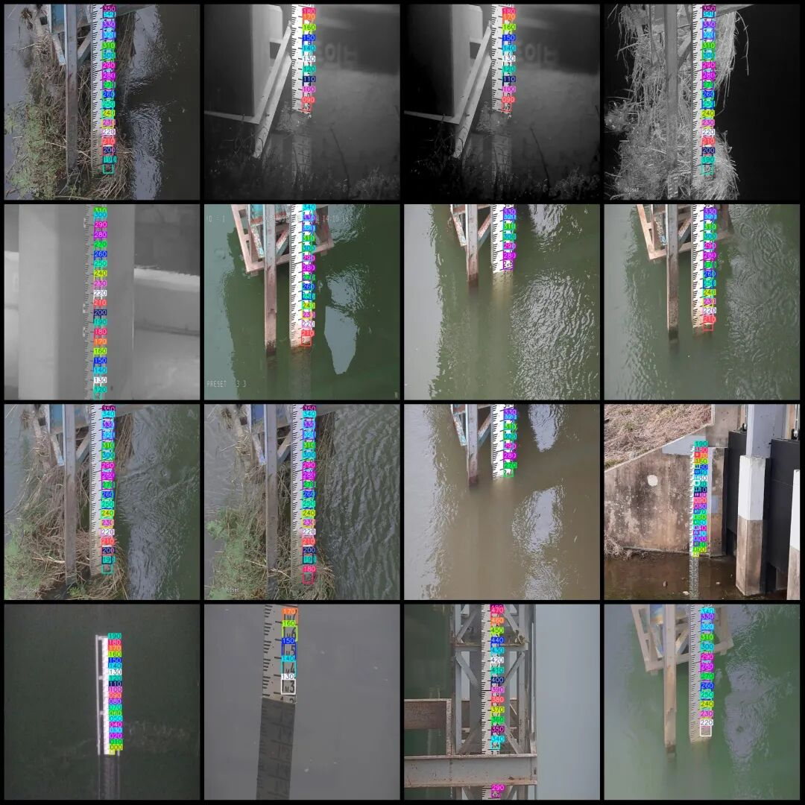
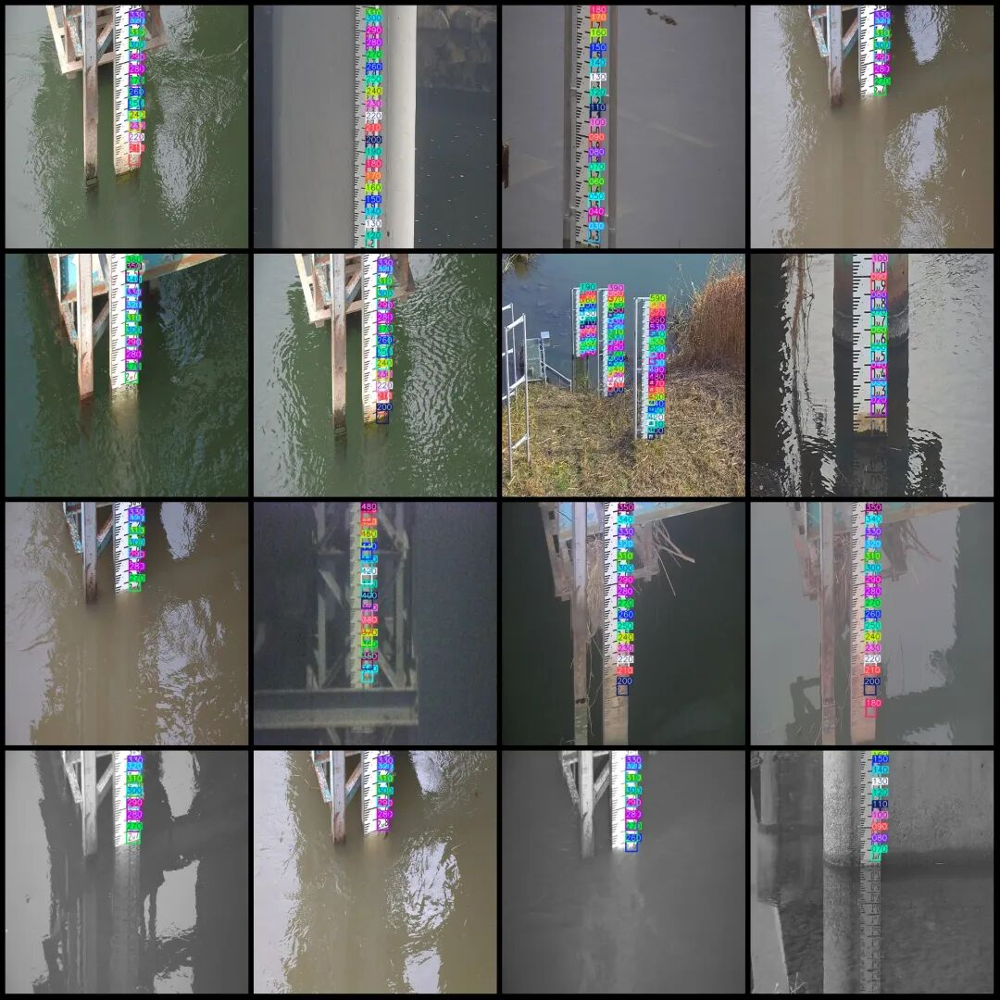

# Water Level Gauge Readings Measurement Data Set - VOC+YOLO Format - 493 Images, 60 Categories

Please note that the dataset contains approximately 220 images, which are the original ones, and the remaining are enhanced generated images.

Dataset format: Pascal VOC format + YOLO format (txt file without split path, only containing jpg images and corresponding VOC format xml files and yolo format txt files)

Number of images (number of jpg files): 493

Number of annotations (number of xml files): 493

Number of annotations (number of txt files): 493

Labeling category count: 60

Label category names (Note that the order of yolo format categories does not correspond to this, but is based on the labels folder's classes.txt): ["000", "010", "020", "030", "040", "050", "060", "070", "080", "090", "100", "110", "120", "130", "140", "150", "160", "170", "180", "190", "200", "210", "220", "230", "240", "250", "260", "270", "280", "290", "300", "310", "320", "330", "340", "350", "360", "370", "380", "390", "400", "410", "420", "430", "440", "450", "460", "470", "480", "490", "500", "510", "520", "530", "540", "550", "560", "570", "580", "590"]

Number of boxes labeled in each category:

000 Frames = 21

010 Frames = 30

020 Frames = 45

030 Frames = 66

040 Frames = 72

050 Frames = 63

060 Frames = 72

070 Frames = 108

080 Frames = 114

090 Frames = 123

100 frames = 123

110 Frames = 123

120 frames = 141

130 frames = 152

140 frames = 146

150 frames = 146

160 frames = 146

170 Frames = 125

180 frames = 125

190 Frames = 137

200 frames = 147

210 Frames = 174

220 Frames = 233

230 Frames = 232

240 frames = 231

250 frames = 240

260 frames = 243

270 Frames = 278

280 Frames = 308

290 Frames = 317

300 frames = 302

310 Frames = 302

320 frames = 290

330 frames = 300

340 frames = 178

350 frames = 134

360 frames = 53

370 Frames = 29

380 Frames = 29

390 Frames = 29

400 frames = 26

410 Frames = 25

420 Frames = 25

430 Frames = 25

440 Frames = 25

450 frames = 22

460 Frames = 22

470 Frames = 22

480 Frames = 21

490 Frames = 12

500 frames = 12

510 Frames = 12

520 Frames = 6

530 Frames = 6

540 frames = 6

550 frames = 6

560 Frames = 6

570 Frames = 6

580 Frames = 6

590 Frames = 6

Total frame count: 6424

Number of images per category:

000 Number of images owned = 21

010 Num of images owned = 30

020 Number of images owned = 45

030 Number of images owned = 66

040 Number of images owned = 72

050 Number of images owned = 63

060 Number of images owned = 72

070 Number of images owned = 108

080 Ownership of Images = 114

090 Number of images owned = 123

100 Ownership of images = 123

110 Ownership of Images = 123

120 Ownership of images = 141

130 Number of images owned = 152

140 Num of images = 146

150 Ownership of images = 146

160 Ownership of images = 146

170 Ownership of images = 122

180 Ownership of images = 125

190 Number of images owned = 137

200 Ownership of images = 147

210 Ownership of Images = 174

220 Number of images owned = 233

230 Number of images owned = 232

240 Ownership of images = 231

250 Ownership of images = 240

260 Ownership of images = 243

270 Ownership of images = 278

280 Ownership of images = 308

290 Ownership of images = 317

300 Ownership of images = 302

310 Ownership of images = 302

320 Ownership of images = 290

330 Ownership of images = 300

340 Ownership of images = 178

350 Ownership of images = 134

360 occupies the number of images = 53

370 Ownership of images = 29

380 Ownership of images = 29

390 Ownership of images = 29

400 Ownership of images = 26

410 Number of images owned = 25

420 Number of images owned = 25

430 Number of images owned = 25

440 Ownership of images = 25

450 Ownership of images = 22

460 Ownership of images = 22

470 Ownership of images = 22

480 Ownership of images = 21

490 Number of images owned = 12

500 Ownership of images = 12

510 Ownership of images = 12

520 Num of images = 6

530 Number of images owned = 6

540 Ownership of images = 6

550 Ownership of images = 6

560 Ownership of images = 6

570 Ownership of images = 6

580 Ownership of images = 6

590 Ownership of images = 6

Image resolution: 640x640

Using labelImg:

Annotation rules: Draw a rectangle around the category.

Important Notice: The dataset does not have separate training, validation, and test sets; you need to partition them yourself.

Special : This dataset does not guarantee the accuracy of the trained models or weight files.

Image Preview:

Annotation example:

## Payment

Here is a pay link on Stripe ( https://buy.stripe.com/3cs8yP7sY87d0vu9AB ). Please contact me lonlonago@foxmail.com after funding $89, and I will send you a complete data files , thank you!

